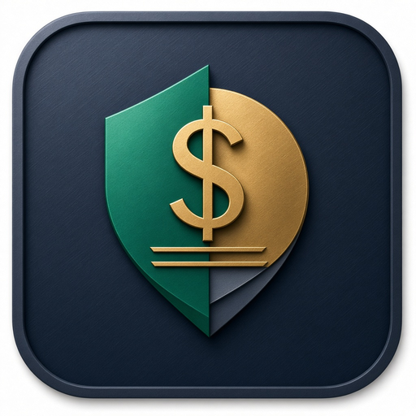

# Spendable Deluxe

  

**Spendable Deluxe** is a local-first, single-file personal finance cockpit that answers one core question at a glance: *"How much can I safely spend today?"*

It protects upcoming bills, essential allowances, savings goals, debt payments, and your cash buffer before calculating your real-time **Safe to Spend Today** figure.

## Highlights
- **Hero Daily Spendable Cockpit:** Instant daily safe-to-spend calculation with an integrated 4-metric KPI strip (*Available Cash*, *Protected Money*, *Spendable Pool*, and *Period Pace*).
- **One-Tap Quick Log & Inline Affordability Bar:** Log frequent everyday expenses (`+ Coffee`, `+ Lunch`, `+ Groceries`, `+ Gas/Transit`, `+ Dining Out`) in a single click, or test any dollar amount inline to see its immediate impact on your daily number.
- **Interactive Cash Allocation:** Unified segmented visual bar and clickable category breakdown.
- **100% Local-First & Private:** Runs entirely in the browser with `IndexedDB` + `localStorage` persistence, optional WebCrypto `AES-256-GCM` App Lock encryption, and full JSON/CSV backup and export.
- **Light, Dark & Auto Themes + Keyboard Shortcuts:** Press `N` (new transaction), `B` (update balances), `A` (affordability calculator), `M` (math breakdown), or `T` (Today view).

## Usage
Open `index.html` (or `spendable-deluxe.html`) directly in any modern desktop or mobile browser, or host via GitHub Pages.
