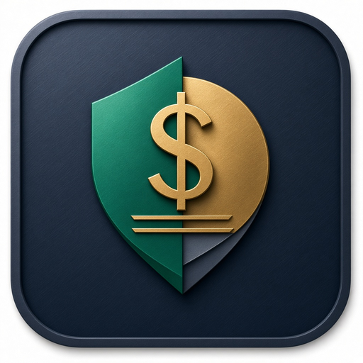

# Spendable Deluxe

  

**Spendable Deluxe** is a local-first, single-file personal finance cockpit that answers one core question at a glance: *"How much can I safely spend today?"*

It protects upcoming bills, essential allowances, savings goals, debt payments, and your cash buffer before calculating your real-time **Safe to Spend Today** figure.

## Highlights
- **Hero Daily Spendable Cockpit:** Instant daily safe-to-spend calculation with an integrated 4-metric KPI strip (*Available Cash*, *Protected Money*, *Spendable Pool*, and *Period Pace*).
- **One-Tap Quick Log & Inline Affordability Bar:** Log frequent everyday expenses (`+ Coffee`, `+ Lunch`, `+ Groceries`, `+ Gas/Transit`, `+ Dining Out`) in a single click, or test any dollar amount inline to see its immediate impact on your daily number.
- **Interactive Cash Allocation:** Unified segmented visual bar and clickable category breakdown.
- **100% Local-First & Private:** Runs entirely in the browser with `IndexedDB` + `localStorage` persistence, optional WebCrypto `AES-256-GCM` App Lock encryption, and full JSON/CSV backup and export.
- **Light, Dark & Auto Themes + Keyboard Shortcuts:** Press `N` (new transaction), `B` (update balances), `A` (affordability calculator), `M` (math breakdown), or `T` (Today view).

## Usage
Open `index.html` (or `spendable-deluxe.html`) directly in any modern desktop or mobile browser, or host via GitHub Pages.

---

# Spendable Tracker (`/tracker`)

A second, full budget-tracker app that lives in [`tracker/`](./tracker/). It's an installable, offline web app (PWA) and works on iPhone, Android and desktop. Open `tracker/index.html` through any web server, or at `<your-pages-url>/tracker/` on GitHub Pages.

## Features
- **Safe to spend:** cash left after bills, subscriptions and savings until your next payday, plus a per-day figure and a tap-to-see breakdown.
- **Quick add:** type an amount and tap a category to save. Descriptions are suggested from your history and pick their category automatically. Includes tags, transfers, planned transactions and a repeat option.
- **Recurring bills, subscriptions and income:** custom schedules (every N days, weeks, months or years) with optional end dates. Each one is logged automatically when due, and you can "Process now" early.
- **Income planning:** a regular paycheck (safe-to-spend runs to payday) or irregular income (runs to period end and tracks a monthly target as money arrives).
- **Upcoming calendar:** a month grid of due payments and daily spending, plus payment reminders (shown when you open the app, as notifications if allowed).
- **Budget tab:** monthly budget per category with groups. Over-budget shows red, there's a pace check, a custom period start day, and you can browse past periods.
- **Insights, with 6 charts:** Spending Breakdown, Spending Trend (Income vs Spending in Year view), Top Spending, Saving Rate (20% benchmark), Money Flow (largest first), and Needs/Wants/Savings (50/30/20). Each has a one-sentence "Explain" worked out on your device. Month and Year views go back in time.
- **Accounts:** checking, savings, credit card and cash, each in its own currency. Balance-over-time chart (1W to All) with touch-to-inspect and a summary, net worth, archive.
- **Auto-log Apple Pay taps and Siri, no bank connection:** an iOS Shortcuts automation opens `tracker/?add=AMOUNT&note=MERCHANT` (optional `category`, `account`, `type`, `tags`, `confirm`). Home-screen shortcuts: Add expense, Add income, What's left.
- **Activity:** search across notes, categories, #tags and amounts, with filters. Swipe left to delete; swipe right on a planned transaction to process it. Select mode for bulk delete, and undo.
- **Spaces:** separate sets of data (personal, household, business), switched in Settings.
- **Data:** CSV import with column mapping, a preview, duplicate skipping and error reporting. CSV export, full JSON backup and restore. 180+ currencies with manual exchange rates.
- **Private:** no account, no sign-in, no network calls. Everything stays in this browser on this device. Light, dark and system themes. Keyboard: `N` new, `/` search, `1`–`5` tabs.
